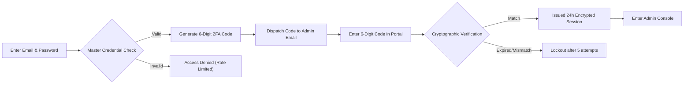
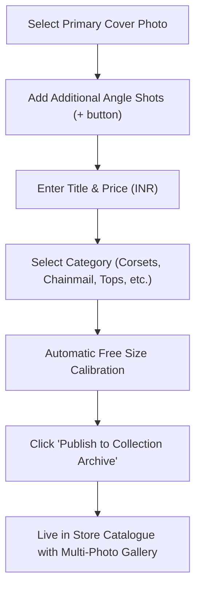

# AVZ VAGANZA — ADMIN MANAGEMENT CONSOLE GUIDE
**Comprehensive Operational Manual & Reference Guide**  
*Version 2.5 • Dual-Factor Authentication (2FA) Security Enabled*

---

## 1. Access & Two-Factor Authentication (2FA)

### 1.1 Console URL
- **Production Admin URL:** [`https://aveezahvaganza.com/admin`](https://aveezahvaganza.com/admin)
- **Login Portal:** [`https://aveezahvaganza.com/admin/login`](https://aveezahvaganza.com/admin/login)

### 1.2 Two-Factor Authentication (2FA) Login Flow
For maximum store security, all administrative sessions require **Two-Factor Authentication**:

1. **Step 1: Master Credentials**
   - Enter your registered administrator email (`avz.vaganza@gmail.com`).
   - Enter your master administrator password.
   - Click **"Verify Password & Send 2FA Code"**.
2. **Step 2: 2FA One-Time Passcode**
   - The security system dispatches a single-use **6-digit security code** to your email.
   - The code is valid for **10 minutes** and expires immediately upon use.
   - Enter the 6 digits in the portal and click **"Authorize & Enter Console"**.
   - If you do not receive the code, a **"Resend Code"** button unlocks after 60 seconds.

> [!NOTE]
> Sessions remain securely active for **24 hours** via an encrypted, HTTP-only cookie (`avz_admin_session`). Logging out immediately terminates the token across all servers.

---

## 2. Media Pool & Website Sections Manager

The **Media & Sections** module is divided into two intuitive operational tiers:
- **Tier 1 (Top):** Master Media Pool (Upload & File Management)
- **Tier 2 (Bottom):** Publish to Website Sections (Assigning content to specific parts of the site)

---

### Tier 1: Master Media Pool (Photo Uploads & Storage)
The Master Media Pool is your central cloud drive. All photographs must first exist here before being assigned to products or museum frames.

#### How to Upload Media:
1. Scroll to **Section 1: Master Media Upload & Pool**.
2. Drag and drop image files directly into the dashed upload dropzone, or click **"Choose Files"**.
3. Supported formats: `.webp`, `.jpg`, `.jpeg`, `.png`.
4. Uploaded files are automatically optimized, compressed, and assigned a high-speed CDN URL.

#### Media Management:
- **Search:** Filter photos by filename in real time.
- **Preview:** Hover over any thumbnail to view a crisp zoom preview.
- **Delete:** Click the red trash icon on any unused photo to permanently purge it from storage.

---

### Tier 2: Publishing to Website Sections

Below the Master Media Pool is **Section 2: Publish to Website Sections**. Here you choose which specific section of the live site you want to update:

| Sub-Section | Website Target | Key Features |
| :--- | :--- | :--- |
| **1. The Vault Pieces** | `#vault` | 3D Interactive Fan Carousel on desktop & smooth swipe rail on mobile |
| **2. Lookbook Archive** | `#lookbook` | Editorial spatial runway drift cards with styling notes |
| **3. Key Pieces** | Shop Header | Top bestseller statement items highlighted in the catalogue |
| **4. Collection Archive** | `#shop` | Main shopping catalogue with categories and multi-photo angle galleries |
| **5. The Archive Gallery** | `#museum` | Digital Museum Wall with antique ornate baroque & brass frames |

---

#### Sub-Section 1: The Vault Pieces (`#vault`)
Archival specimens displayed in the interactive 3D fan carousel.
1. Click tab **"1. The Vault Pieces"**.
2. Click **"Click to Pick a Photo"** and select an uploaded shot from Section 1.
3. Fill in:
   - **Piece Title:** (e.g. *Stainless Steel Mesh Thigh Holster*)
   - **Price (INR):** (e.g. *2980*)
   - **Category Tag:** (e.g. *1 OF 1 ARCHIVE*)
   - **Provenance / Story:** Short historical note about the garment.
4. Click **"Publish to The Vault Pieces"**.

---

#### Sub-Section 2: Lookbook Archive (`#lookbook`)
Editorial campaign portraits and runway captures.
1. Click tab **"2. Lookbook Archive"**.
2. Select your editorial photo from Section 1.
3. Fill in:
   - **Editorial Title:** (e.g. *Dhristroyer Apex Campaign*)
   - **Look Identifier:** (e.g. *LOOK 025 • EDITORIAL RUNWAY*)
   - **Curatorial Subtitle:** High-fashion concept statement.
   - **Materials Breakdown:** (e.g. *Reclaimed Metals, Stainless Chains, Hand-Set Spikes*)
4. Click **"Publish to Lookbook Archive"**.

---

#### Sub-Section 3: Key Pieces (Featured Bestsellers)
Highlights bestselling pieces directly in the top row of the shopping catalogue.
1. Click tab **"3. Key Pieces"**.
2. Select photo, title, price, and category.
3. Click **"Publish to Key Statements"**.

---

#### Sub-Section 4: Collection Archive (`#shop` Catalogue)
The primary customer shopping catalogue where patrons buy 1-of-1 wearable art garments.

#### Multi-Photo Gallery Workflow:
1. Click tab **"4. Collection Archive"**.
2. Click **"Add from Media Pool"** to select the **Primary Cover Photo**.
3. Under **"Additional Angle Shots"**, click **"+ Add Angle"** to attach alternate close-ups, back views, and model angles.
   - *Customer Experience:* Customers see the clean primary card in the grid; when clicked, the modal reveals the multi-photo gallery allowing customers to browse every angle.
4. Fill in:
   - **Product Name:** (e.g. *Acid-Wash Hardware Cargo Skirt*)
   - **Price (INR):** (e.g. *2500*)
   - **Category:** Choose from *Corsets, Chainmail, Tops, Skirts, Co-ords, Belts, Headgear, etc.*
   - **Stock:** Defaults to `1` (for 1-of-1 archive pieces).
   - **Craft Story:** Short statement describing construction.
5. **Sizing:** All pieces are automatically calibrated as **`Free Size • Adjustable Silhouette`** across the entire website. No size configurations are required.
6. Click **"Publish to Website Section"**.

#### Editing & Deleting Published Items:
Beneath each sub-section form, you will find the **"Currently Published"** gallery:
- **Edit:** Click the edit (pencil) icon on any card to load its details and images back into the form for updates.
- **Delete:** Click the trash icon to immediately remove the item from the live storefront.

---

#### Sub-Section 5: The Archive Gallery (`#museum`)
The grand digital museum wall featuring antique Baroque painting frames.
1. Click tab **"5. The Archive Gallery"**.
2. Select high-resolution artwork photo.
3. Select Frame Style:
   - *Ornate Baroque (Antique Carved Gold)*
   - *Gilded Rococo (Regal Filigree)*
   - *Florentine Gold (Burnished Leaf)*
   - *Tarnished Brass (Aged Verdigris Relief)*
4. Fill in Artwork Title, Artist (`Dhrisni & The AVZ Studio`), Year, and Dimensions.
5. Click **"Publish Artwork to Museum Wall"**.

---

## 3. Order Management & Fulfillment

Navigate to the **Orders** tab to inspect and fulfill patron reservations.

### 3.1 Order Status Pipeline
Orders flow through clear stages:
1. **Pending / Reserved:** Patron completed checkout; order logged with unique identifier (e.g. `AVZ-48291`).
2. **Paid / Confirmed:** Payment received via online gateway, UPI verification, or Cash on Delivery.
3. **In Production:** Garment is being tailored and boxed in presentation packaging.
4. **Dispatched:** Tracking courier assigned; tracking email sent to patron.
5. **Delivered:** Order completed.

### 3.2 Order Details & Concierge Actions
Clicking on any order row reveals:
- **Customer Identity:** Full Name, Email, Phone (+91 10-digit verified).
- **Delivery Destination:** Complete street address, city, state, and pincode.
- **Purchased Items:** High-res preview, quantity, price, and item SKU.
- **WhatsApp Concierge Button:** Opens a pre-composed direct WhatsApp chat with the customer, including their exact Order ID and items list.

### 3.3 Exporting Orders
Click **"Export CSV"** in the top right to download an Excel/CSV spreadsheet of all orders for shipping logistics.

---

## 4. Bespoke Piece Requests & Custom Commissions

Navigate to the **Piece Requests** tab to review bespoke commission inquiries submitted by customers through the website.
- Each inquiry includes the customer's Name, Phone, Email, Requested Silhouette, and custom hardware preferences.
- Click **"Message on WhatsApp"** to immediately respond with pricing, sizing confirmation, and production timelines.

---

## 5. Storefront & Security Settings

Navigate to the **Settings** tab to manage global e-commerce controls:

1. **Emergency Purchase Pause (Kill Switch):**
   - Toggle **"Purchases Enabled"** off if the studio is at full manufacturing capacity or on runway break.
   - You can customize the pause message shown to customers in the cart.
2. **Shipping & Logistics Rates:**
   - Configure the flat Express Courier fee (default: `₹250`).
   - Configure the Free Delivery threshold (default: `₹5,000`).
3. **Security Status Banner:**
   - Displays real-time **Two-Factor Authentication (2FA)** status.
   - Shows active database connections (Turso SQLite / LibSQL).

---

## 6. Administrator Security Best Practices

> [!IMPORTANT]
> 1. **Protect your 2FA Email:** Security passcodes are sent exclusively to `avz.vaganza@gmail.com`. Ensure that email account has strong credentials and recovery phone verification enabled.
> 2. **Single-Use Passcodes:** 2FA codes expire after 10 minutes or upon first use.
> 3. **Brute-Force Lockout:** The system automatically locks out IP addresses that exceed 5 failed login attempts or 8 invalid 2FA attempts for 15 minutes.
> 4. **Session Expiry:** Admin sessions automatically expire after 24 hours of inactivity.
